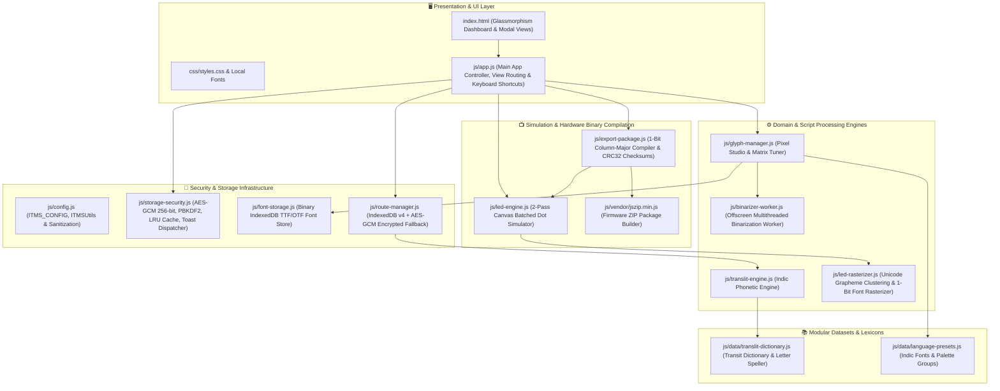
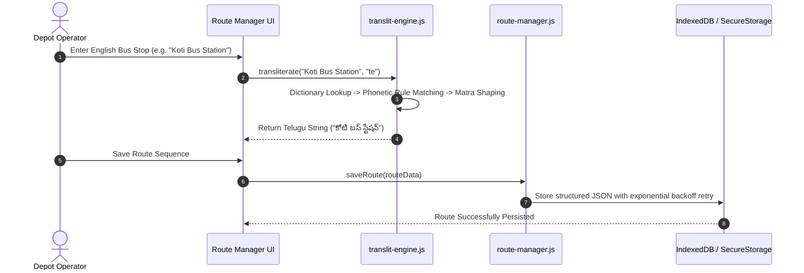
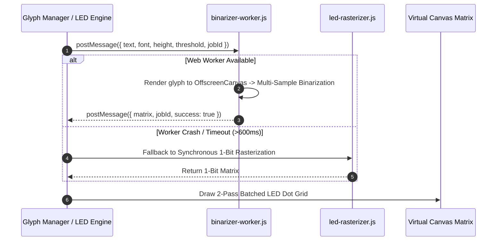
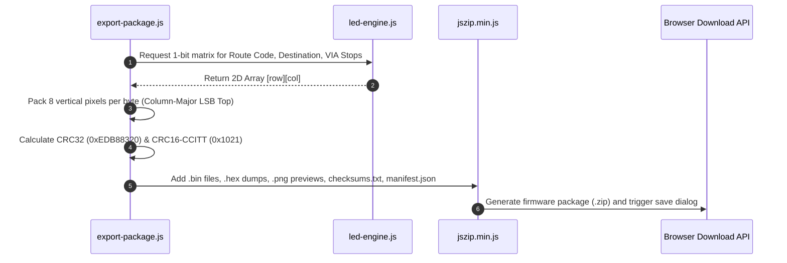
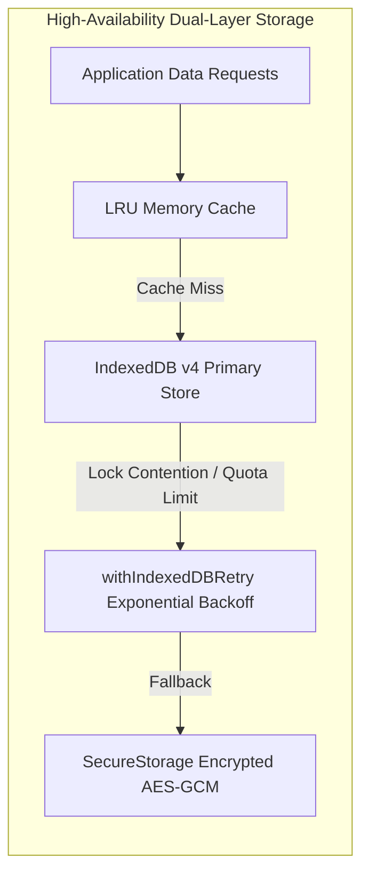

# 🏛️ ITMS LED Suite — System Architecture & Design Document
**Containe Technologies Limited — Version 2.1.0**

---

## 1. 🌟 System Overview & Core Design Principles

The **ITMS LED Bitmap & Bus Route Information Management Suite** is an industrial-grade, client-side application engineered for public transit depot environments. It manages multi-lingual bus route sequence data, tunes custom Indic font matrices, simulates physical Hub75/Hub08 LED destination displays in real-time, and compiles hardware-ready firmware binary bundles.

### Core Architectural Principles
1. **Zero-Build Native Execution**: Built with standard modern JavaScript (ES6+), HTML5 Canvas, and Vanilla CSS. No Node.js or Webpack build pipelines are required at runtime—it boots natively in any modern browser or embedded WebView.
2. **100% Air-Gapped Offline Operation**: Zero external API dependencies, zero analytics trackers, and zero external CDN font links. All TrueType fonts, icons, and libraries are locally bundled and cached via a dedicated Service Worker.
3. **Unified Namespace (`window.ITMS`)**: Clean, structured module registration under the `window.ITMS` namespace with 100% backward-compatible global references.
4. **High-Performance 60 FPS Simulation**: Utilizes 2-pass Canvas path batching and offscreen Web Workers to simulate high-density LED matrix boards (up to 512×64 diodes) at < 1.5ms per frame.

---

## 2. 🧩 High-Level Component Architecture



---

## 3. 🔄 End-to-End Data Flow Pipelines

### A. Bus Route Creation & Automatic Indic Transliteration Pipeline


---

### B. 1-Bit Font Rasterization & Multithreaded Binarization Pipeline


---

### C. 2-Pass Canvas Batched Rendering Pipeline (60 FPS Performance)
Traditional HTML5 Canvas LED rendering draws each dot with separate `beginPath()`, `arc()`, and `fill()` calls, resulting in over **16,384 draw calls per frame** for a 64×256 matrix. The ITMS Suite utilizes a **2-Pass Path Batching Algorithm**:

1. **Pass 1 (Inactive Matrix Grid)**:
   - Iterates through all inactive (OFF) pixel coordinates.
   - Appends circular well subpaths into a single composite path.
   - Executes a single `ctx.fill()` with background diode color (`#1b1d28`).
2. **Pass 2 (Illuminated Diodes)**:
   - Iterates through active (ON) diode coordinates.
   - Batches all active diode subpaths and executes a single `ctx.fill()` with primary LED color (`#ff2a2a` or `#ffaa00`).
   - Adds a single radial blur pass for physical diode phosphor glow.
3. **Benchmark**: Renders 64×512 matrix displays in **< 1.5ms at 60 FPS** with zero frame drops.

---

### D. Firmware Binary Compilation Pipeline


---

## 4. 🔒 Cryptographic & Security Architecture

| Security Layer | Implementation Mechanism | Purpose & Threat Defense |
| :--- | :--- | :--- |
| **Data Encryption at Rest** | Web Crypto API **AES-GCM (256-bit)** in [`storage-security.js`](file:///c:/Users/Manikanta/Desktop/LED%20COMPANY_1/js/storage-security.js) | Prevents cleartext exposure of transit route information if workstation localStorage is inspected. |
| **Device-Specific Key Derivation** | Dynamic 256-bit Installation Entropy + **PBKDF2 (100,000 Iterations)** | Eliminates static/hardcoded salt vulnerabilities. Every physical machine derives its own unique encryption key. |
| **Cryptographic IV Uniqueness** | `crypto.getRandomValues(new Uint8Array(12))` | Ensures every AES-GCM encryption write produces a cryptographically unique 96-bit initialization vector. |
| **Content Security Policy (CSP)** | Enforced in `<meta http-equiv="Content-Security-Policy">` | Guarantees zero network egress (`connect-src 'self'`), blocks clickjacking (`frame-ancestors 'none'`), and prevents remote script injection. |
| **DOM XSS Sanitization** | `ITMSUtils.escapeHtml()` & `ITMSUtils.escapeAttr()` | Sanitizes route names, stop strings, and metadata before inserting into HTML or attribute contexts. |
| **CSV Formula Injection (DDE)** | `ITMSUtils.sanitizeCsvCell()` | Neutralizes Excel/Calc formula trigger characters (`=`, `+`, `-`, `@`, `\t`, `\r`, `%`) with a leading single quote. |

---

## 5. 💾 Storage Layer & Fault-Tolerant Resilience



1. **Primary Layer (`ITMS_Route_DB_v4`)**:
   - IndexedDB object store with versioned schemas for Routes and Custom TrueType Fonts.
   - Wrapped in [`withIndexedDBRetry()`](file:///c:/Users/Manikanta/Desktop/LED%20COMPANY_1/js/config.js#L140) with exponential backoff (`50ms * 2^attempt`) to survive transaction locks.
2. **Secondary Fallback Layer (`SecureStorage`)**:
   - Synchronous, in-memory bounded LRU cache with automatic AES-GCM encrypted persistence to `localStorage`.
3. **Automated Data Migration**:
   - Seamlessly upgrades legacy v1 XOR records to AES-GCM v2 upon first read without user intervention.

---

## 6. 🔌 Hardware Binary Protocol Specifications

Physical LED controllers (Hub75, Hub08, TF-series, HD2016) read monochrome bitmap data encoded in **1-bit Column-Major order**:

```
Byte 0 (Col 0, Rows 0-7):
  Bit 0 (LSB) -> Row 0 (Top Pixel)
  Bit 1       -> Row 1
  Bit 2       -> Row 2
  Bit 3       -> Row 3
  Bit 4       -> Row 4
  Bit 5       -> Row 5
  Bit 6       -> Row 6
  Bit 7 (MSB) -> Row 7 (Bottom Pixel)

Byte 1 (Col 0, Rows 8-15) -> Next vertical 8-pixel block in Column 0
...
Byte N -> Next column
```

### Hardware Verification Checksums
Every generated package includes both checksum standards verified during bootloader flash:
- **CRC32**: IEEE 802.3 polynomial `0xEDB88320`
- **CRC16**: CCITT polynomial `0x1021` (Initial value `0xFFFF`)

---

## 7. 📁 Directory & Module Layout

```text
LED COMPANY_1/
├── index.html                   # Master Glassmorphism UI & View Container
├── app.webmanifest              # PWA Installation Manifest
├── sw.js                        # Service Worker (100% Offline PWA Asset Caching)
├── start_app.bat                # Standalone One-Click Windows Launcher
├── ARCHITECTURE.md              # System Architecture & Technical Design Document
├── README.md                    # User Guide & Operations Manual
├── css/
│   ├── styles.css               # Core Stylesheet (Glassmorphism, Layout & Grid)
│   └── fonts/                   # 100% Self-Hosted Local Indic & Latin WebFonts
└── js/
    ├── config.js                # Centralized System Config, Matrix Profiles & XSS Utils
    ├── storage-security.js      # Web Crypto AES-GCM, PBKDF2, LRU Cache & Toast Dispatcher
    ├── font-storage.js          # Binary TTF/OTF IndexedDB Storage Engine
    ├── translit-engine.js       # Indic Phonetic Transliteration Engine (Algorithmic Logic)
    ├── led-rasterizer.js        # Unicode Grapheme Segmentation & 1-Bit Pixel Optimizer
    ├── led-engine.js            # 2-Pass Canvas Batched LED Matrix Simulator & Physics
    ├── route-manager.js         # Route Sequence Data Layer & CSV/JSON Serializer
    ├── export-package.js        # 1-Bit Column-Major Firmware Compiler & CRC Checksums
    ├── glyph-manager.js         # Pixel Studio, Manual Dot Editor & Subtab Manager
    ├── binarizer-worker.js      # Offscreen Web Worker for Non-Blocking Binarization
    ├── app.js                   # Application Router, Lifecycle & Keyboard Shortcuts
    ├── types.d.ts               # TypeScript Type Definitions & JSDoc Interfaces
    ├── data/                    # Modular Datasets, Transit Lexicons & Presets
    │   ├── translit-dictionary.js # 2,180+ Hyderabad Transit Lexicon & Letter Speller
    │   └── language-presets.js    # Font Configurations, Shaping & Glyph Palettes
    └── vendor/
        ├── jszip.min.js         # Local ZIP Compression Engine
        ├── bootstrap-icons.css        # Local SVG Icon Engine
        └── opentype.min.js      # Local TrueType/OpenType Vector Font Parser
```
